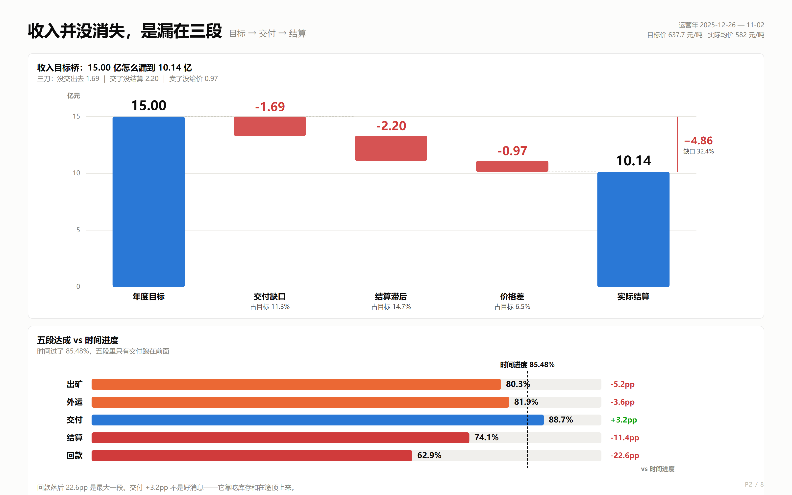

# 经营看板搭建 Skill · operating-dashboard-skill

> 一套做经营看板的**两阶段方法**：从业务主链推出该看的指标，再把它落成能开会用的看板。
> 不是一个图表模板库，解决的是 **"画出来的数为什么不能拿去开会"**。

[](LICENSE)
[](SKILL.md)

---

## 一句话内核

> **看板不是把表画成图，是把「一个能拍板的判断」拆成几屏，每屏都让人少问一个问题。**
>
> 图能画出来，不代表字和数是同一个来源 —— 这是本方法论最贵的一条教训。



*案例产物示例：收入目标 15.00 亿 → 实际 10.14 亿，瀑布拆出交付 / 结算 / 价格三段漏损；下半屏五段达成率各用各的分母。*

---

## 它解决什么

| 常见做法 | 本方法 |
|---|---|
| 先画图，再去找数 | **先定口径，再取数，最后才是图** |
| 一张表算所有屏 | 一屏一张表，表是图的唯一数据源 |
| 五段完成率横向比 | 每段**各有各的分母**，不许共用一个计划值 |
| 没数先填 0 | 空 ≠ 0，标「待提取」+ 画骨架 |
| 图注凭印象手写 | 注文里每个数都能从数组算出来 |
| 把一句话需求丢给智能体 | 八件事规格 + 分批 + 回执实测值 |

---

## 两阶段

| | 阶段一 · 设计 | 阶段二 · 落地 |
|---|---|---|
| 回答 | 该看什么、怎么表达 | 怎么把它真的做出来 |
| 五步 / 四步 | 原理 → 指标 → 模板 → 表达 → 数据表 | 规格 → 分页构建 → 闸门 → 验收 |
| 产物 | 逐屏规格 + 取数表 + 图稿 | 可切换的看板 + 回执 + 验收 |
| 停点 | 每条口径签字 | 每屏回执后停 |

---

## 安装

### Claude Code

```bash
# 注意：克隆到 dashboard-builder 目录（skill 按目录名发现）
git clone https://github.com/z8ilon1g/operating-dashboard-skill.git ~/.claude/skills/dashboard-builder
```

项目级安装同理，放到 `<your-project>/.claude/skills/dashboard-builder/`。

### Codex / skills.sh

```bash
npx skills add z8ilon1g/operating-dashboard-skill
```

### 手动

把整个仓库复制为 `dashboard-builder/` 放入 skills 目录即可，无任何依赖、无脚本需要运行。

---

## 触发方式

安装后直接说需求即可，或使用触发词：

- 「做看板」「搭看板」「经营看板」「管理驾驶舱」「看板搭建」「看板设计」
- 「把数据变成图」「指导元芳搭看板」「飞书看板」
- 英文：dashboard、business dashboard

**不适用**：只需要一张静态报表；指标口径还没定就想要图（先做口径，见 `references/03-口径纪律.md`）。

---

## 仓库结构

```
operating-dashboard-skill/
├── SKILL.md                      ← 主入口（两阶段总览 + 十一条硬规则）
├── references/
│   ├── 01-设计阶段.md             ← 五步展开：原理 / 指标 / 模板 / 表达 / 数据表
│   ├── 02-落地阶段.md             ← 逐屏规格写法 + 智能体指令模板 + 分批节奏
│   ├── 03-口径纪律.md             ← 12 个真实踩坑与判据（最值钱的部分）
│   ├── 04-验收清单.md             ← 单屏 + 总体验收 + 回执格式
│   └── 05-试跑记录-20261106.md    ← 用新屏验证 v1.0，暴露的方法缺口
├── templates/
│   ├── 逐屏规格模板.md            ← 每屏八件事
│   └── 数据表字段模板.md          ← 一屏一表 + 四种专用表结构
└── examples/
    ├── 案例-磷矿企业8屏看板.md     ← 完整案例：背景 / 8 屏 / 6 个真实返工
    ├── P1b.png                    ← 库房网络（时点口径）
    ├── P2.png                     ← 收入桥（YTD 口径）
    └── P7-trial.png               ← 回款与应收（一屏混两种口径的试点）
```

---

## 五分钟上手

1. 读 `SKILL.md` 的「两阶段总览」和「十一条硬规则」
2. 照 `templates/逐屏规格模板.md` 写第一屏的八件事
3. 照 `templates/数据表字段模板.md` 建第一张表
4. 照 `references/02-落地阶段.md` §C 写第一段给智能体的指令
5. 建完一屏，照 `references/04-验收清单.md` 的单屏验收走一遍

**赶时间的最小路径**：

```
定口径（1 小时）→ 画主链 + 三个指标（半天）→ 建一张表 + 一屏图（一天）
→ 给智能体一页规格（半天）→ 回执验收（半天）
```

先跑通一屏，比一次设计八屏更能暴露口径问题。

---

## 十一条硬规则（违反任何一条，返工）

1. 先定口径再取数，口径没签字不动图
2. 五段各有各的分母，不许共用一个计划值
3. 合计行不许分摊，单仓没盘存就标待提取
4. 空 ≠ 0，缺数据画骨架，不填估算
5. 售价不是成本，不能用售价反算存货占用
6. 同一驱动不许重复计数
7. 折年天数全站统一
8. 注文与数组同源
9. 快照要标时点
10. 智能体只报告不顺手修
11. 一屏混两种口径时必须分区标注

> 每一条都对应一个真实踩坑，见 `references/03-口径纪律.md`。

---

## 关于案例

案例取自一次真实的磷矿企业产运销看板落地（2026-11，8 屏 / 11 张取数表 / 飞书实现）。
**公司名与企业标识已匿名化**，保留数字是为了让口径教训可复算。

换项目时请**只抄方法，不抄数**：5.19、85.48、1,672 都是案例里的，换了业务全部要重算。

---

## 授权

[MIT](LICENSE) © 2026 z8ilon1g

可自由使用、修改、分发，保留出处即可。
